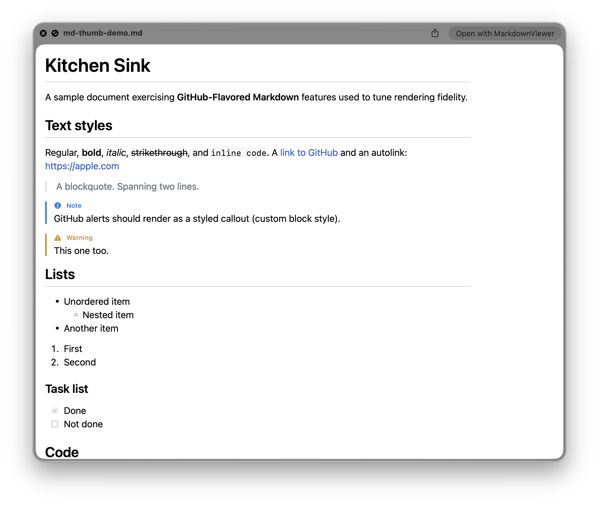
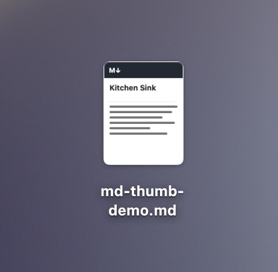
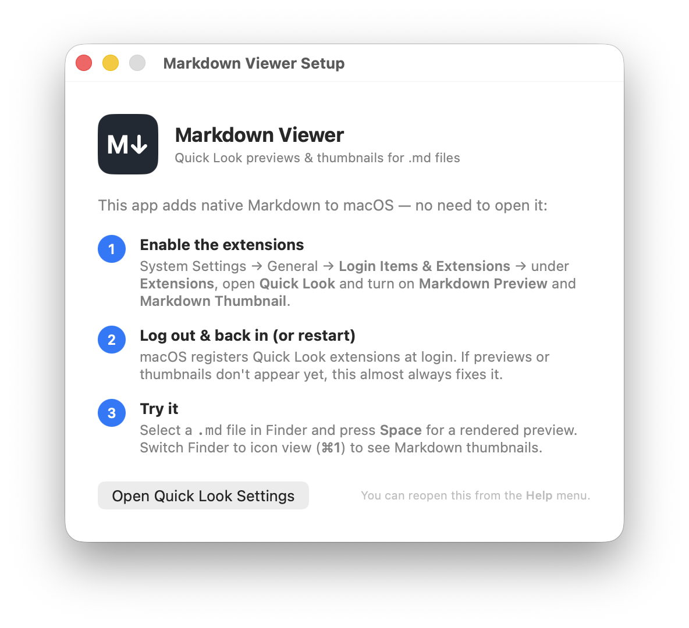
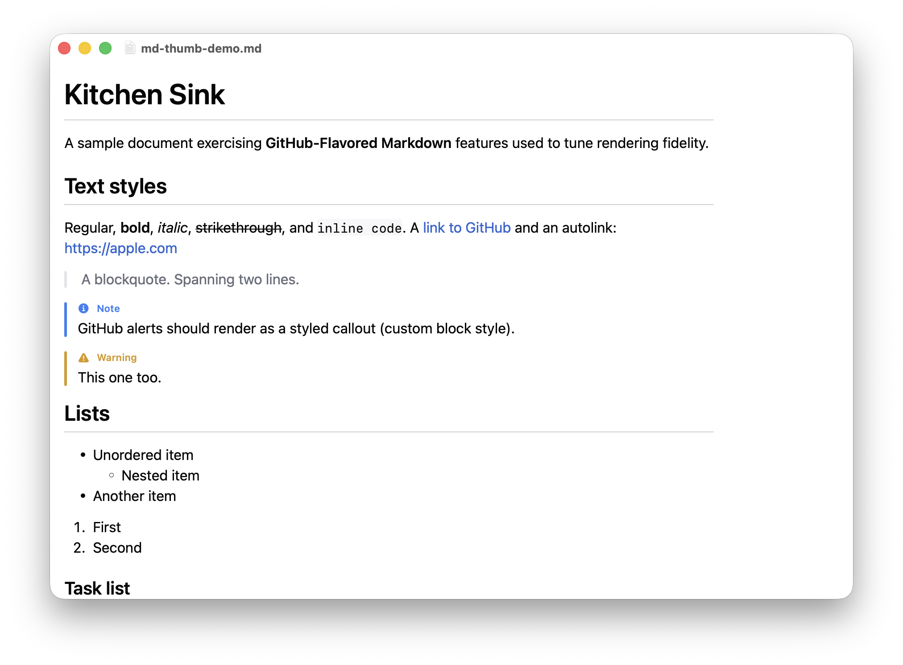

# Markdown Viewer

Make Markdown feel like a **native filetype** on macOS — rendered Quick Look
previews, distinctive Finder thumbnails, and a clean GitHub-styled reader. No
vault, no subscription: press <kbd>Space</kbd> on a `.md` and read it the way it
was meant to look.

A native SwiftUI app with a shared rendering engine and Quick Look extensions.

<p align="center">
  
  
</p>

> Quick Look preview (spacebar / Spotlight) · Finder thumbnail

## Install

**Requires macOS 15 or later.**

1. Download `MarkdownViewer-notarized.zip` from the
   [latest release](https://github.com/hazzahex/markdown-viewer/releases/latest),
   unzip, and drag **MarkdownViewer.app** to **/Applications**.
   It's notarized and Developer-ID signed — no Gatekeeper warning.
2. Open it once. A **Setup** window walks you through the rest:

<p align="center"></p>

3. **System Settings → General → Login Items & Extensions → Quick Look** →
   enable **Markdown Preview** and **Markdown Thumbnail**.
4. (Optional fix) Sometimes Quick Look entries are not registered until after a log out and log in.

Then press <kbd>Space</kbd> on any `.md` in Finder, or switch Finder to icon view
to see thumbnails. There's also a standalone reader (open a `.md` with the app):

<p align="center"></p>

Rendering covers GitHub-Flavored Markdown: headings, tables, task lists,
blockquotes, fenced code with **syntax highlighting** (~190 languages), GitHub
**alerts** (`> [!NOTE]`, `> [!WARNING]`, …), links, and images — all native
SwiftUI, dark-mode aware, no WebView.

## A note on iOS

The same codebase also builds an iOS/iPadOS app (a reader + Markdown thumbnails in
Files). It isn't distributed here — and notably, iOS **never invokes third-party
Quick Look *preview* extensions for text types** like Markdown (it always uses its
built-in text viewer; this is architectural, confirmed on-device and in Apple's
docs/forums). So the full spacebar-preview experience is **macOS only**, which is
what this project ships. (macOS thumbnails, conversely, only register after a
**reboot/relogin** — the quirk the Setup window explains.)

## Architecture

```
project.yml                          # XcodeGen spec — source of truth for all targets
Packages/MarkdownRenderer/           # shared SwiftUI rendering engine (SPM)
  MarkdownReaderView                 #   Textual StructuredText + GitHub style (cross-block selection)
  TaskListMarkers                    #   - [ ] / - [x] task-list items
  GitHubAlert                        #   [!NOTE]/[!WARNING]/… callouts
App/Sources/                         # SwiftUI host app (macOS + iOS), DocumentGroup reader
Extensions/QuickLookPreviewMac/      # macOS Quick Look preview extension
Extensions/QuickLookThumbnail*/      # thumbnail extensions (iOS + macOS)
scripts/release-mac.sh               # archive → notarize → staple → zip
```

The rendering engine is shared by the app and every extension. The `.xcodeproj` is
**generated** by [XcodeGen](https://github.com/yonaskolb/XcodeGen) from
`project.yml`, not committed.

## Building from source

For contributors. Requires **Xcode 26+** (built against Xcode 27) and
`brew install xcodegen`.

```sh
xcodegen generate
xcodebuild -project MarkdownViewer.xcodeproj -scheme MarkdownViewer-mac \
  -destination 'platform=macOS' build
```

Signed/notarized release builds use `scripts/release-mac.sh` — see
[`Distribution/README.md`](Distribution/README.md). Contributors should set their
own `DEVELOPMENT_TEAM` / bundle-identifier prefix in `project.yml`. See also
[`CONTRIBUTING.md`](CONTRIBUTING.md).

## Dependencies

[Textual](https://github.com/gonzalezreal/textual) (MIT): native SwiftUI
rendering, GitHub style, Prism-based syntax highlighting, and text selection
that spans the whole document.

## License

[MIT](LICENSE).
